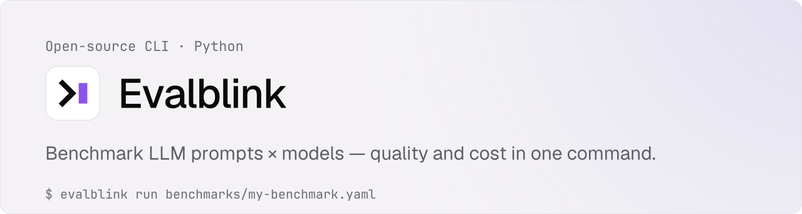
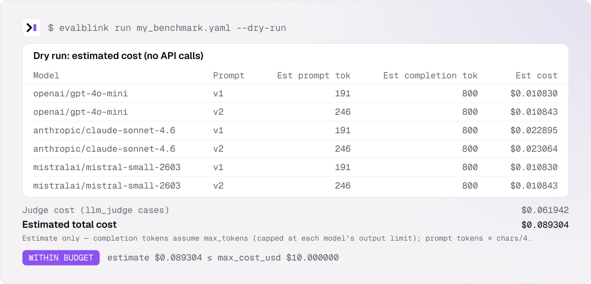
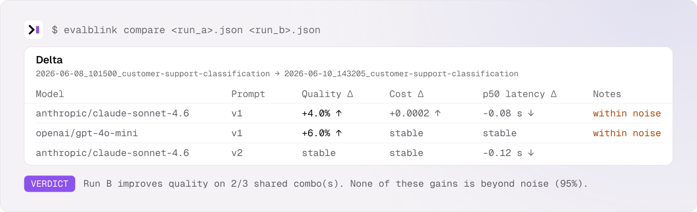

Vendor-neutral Python CLI to benchmark LLM prompts and models on your own data: quality, cost and latency, with the confidence interval that tells you whether a difference is real.

```bash
pipx install evalblink        # or: uv tool install evalblink
evalblink init                # 3 questions (Enter = defaults) → a starter benchmark that runs as-is
evalblink run benchmarks/my-benchmark.yaml
```

Rather keep your test cases in a spreadsheet? `evalblink init --csv` writes them as `benchmarks/my-benchmark.csv`, next to the YAML.

---

## Why evalblink

- **Python-native.** `pip install` and a YAML file. No Node.js, no SDK to wrap your code in.
- **Vendor-neutral.** Every major model through [OpenRouter](https://openrouter.ai), with one API key. Not owned by any vendor you're evaluating.
- **Your data, not public benchmarks.** Public benchmarks leak into training data; your prompts, inputs and labels don't.
- **Quality, cost and latency together.** Cost per model × prompt (judge calls included), p50 / p95 latency, and a dry run that estimates the bill before you spend a cent.
- **Honest numbers.** Every score comes with a 95 % interval, and the recommendation says which combos are within noise of the best — so 2 points on 50 cases isn't read as a winner.
- **CI-ready.** Exit codes, a quality gate, a regression check against a baseline, and a ready-made GitHub Action.

---

## What it does

Define a benchmark in YAML. Run one command. Get a results matrix, a Markdown report, a JSON record, and a local cache so prompt iteration costs almost nothing.


<details>
<summary>Full output as text</summary>

```
Running 300 cases (3 models × 2 prompts × 50 test cases), 5 at a time
[  1/300] openai/gpt-4o-mini / v1 / conv_001  pass  0.58s
[  2/300] openai/gpt-4o-mini / v1 / conv_002  fail  0.66s
…
[ 48/300] openai/gpt-4o-mini / v1 / conv_048  ⚠ API error: OpenRouter request timed out after 4 attempt(s)
…
                    Customer Support Classification — 2026-06-10_143205_customer-support-classification
┏━━━━━━━━━━━━━━━━━━━━━━━━━━━━━━┳━━━━━━━━┳━━━━━━━━━━━━━━━━┳━━━━━━━━━━━━━┳━━━━━━━━┳━━━━━━━━━━━━━━━┳━━━━━━━━━━━┳━━━━━━━━━━━━━┓
┃ Model                        ┃ Prompt ┃ Score (95% CI) ┃ Pass/Scored ┃ Errors ┃ Tokens in/out ┃      Cost ┃ p50 latency ┃
┡━━━━━━━━━━━━━━━━━━━━━━━━━━━━━━╇━━━━━━━━╇━━━━━━━━━━━━━━━━╇━━━━━━━━━━━━━╇━━━━━━━━╇━━━━━━━━━━━━━━━╇━━━━━━━━━━━╇━━━━━━━━━━━━━┩
│ openai/gpt-4o-mini           │ v1     │  87.8% (76–94) │       43/49 │      1 │      4018/294 │ $0.000784 │      0.61 s │
│ openai/gpt-4o-mini           │ v2     │  90.0% (79–96) │       45/50 │      0 │      5000/300 │ $0.000960 │      0.71 s │
│ anthropic/claude-sonnet-4.6  │ v1     │  94.0% (84–98) │       47/50 │      0 │      4100/300 │ $0.017500 │      1.54 s │
│ anthropic/claude-sonnet-4.6  │ v2     │  96.0% (87–99) │       48/50 │      0 │      5000/300 │ $0.021000 │      1.53 s │
│ mistralai/mistral-small-2603 │ v1     │  85.4% (73–93) │       41/48 │      2 │      3936/288 │ $0.000768 │      0.52 s │
│ mistralai/mistral-small-2603 │ v2     │  88.0% (76–94) │       44/50 │      0 │      5000/300 │ $0.000960 │      0.50 s │
└──────────────────────────────┴────────┴────────────────┴─────────────┴────────┴───────────────┴───────────┴─────────────┘
          QUALITY BY TAG — best combo
          QUALITY BY TAG — best combo
      (anthropic/claude-sonnet-4.6 / v2)
┏━━━━━━━━━━━━━┳━━━━━━━┳━━━━━━━━━┳━━━━━━━━┳━━━━┓
┃ Tag         ┃ Cases ┃ Quality ┃ Errors ┃    ┃
┡━━━━━━━━━━━━━╇━━━━━━━╇━━━━━━━━━╇━━━━━━━━╇━━━━┩
│ edge_case   │     5 │     60% │      0 │ ⚠️ │
│ non_english │     4 │     50% │      0 │ ⚠️ │
│ billing     │    12 │    100% │      0 │    │
│ easy        │    30 │    100% │      0 │    │
│ medium      │    15 │    100% │      0 │    │
└─────────────┴───────┴─────────┴────────┴────┘

RECOMMENDATION
Best quality : anthropic/claude-sonnet-4.6 / v2 (96.0%, 95% CI 87–99%)
Within noise : anthropic/claude-sonnet-4.6 / v1 (94.0%), openai/gpt-4o-mini / v2 (90.0%) and 3 more — not distinguishable from the best at 95%; add test cases to separate them.
Best value   : openai/gpt-4o-mini / v1 (87.8% · $0.0008/run)
Fastest      : mistralai/mistral-small-2603 / v2 (p50 0.50 s · 88.0%)
3 pipeline error(s) excluded from scoring.
⚠️  Warning  : edge_case quality is below 70%.
⚠️  Warning  : non_english quality is below 70%.
Results saved to results/2026-06-10_143205_customer-support-classification.json
Markdown report saved to results/2026-06-10_143205_customer-support-classification.md

⚠  3 of 300 case(s) hit a pipeline error (API / judge failure) and are excluded from scores.

PASS: best score meets quality_threshold (85).
```

</details>

A sample 50-case run (3 models × 2 prompts, `quality_threshold: 85`) in which three calls timed out. Read it this way:

- **Score (95% CI)** is the pass rate over the cases that could be scored, and the range it would plausibly take on other cases like yours. A failed API call or judge reply is a *pipeline error*: counted under **Errors**, never as a wrong answer.
- **Within noise** lists the combos that can't be told apart from the best one. Here, with 50 cases, five combos tie: pick on cost (**Best value**) or speed (**Fastest**), or add cases.
- **Quality by tag** shows where the best combo breaks: a 96 % average can hide 50 % on non-English messages.
- The last line is the CI gate. Progress goes to stderr and results to stdout, so `evalblink run bench.yaml > results.txt` keeps only the results.

---

## Quickstart

**1. Install and set your key**

```bash
pipx install evalblink        # or: uv tool install evalblink / pip install evalblink
export OPENROUTER_API_KEY=your_key_here    # or put it in a .env file
```

`validate` and `run --dry-run` need no key. Developing evalblink itself? `pip install -e ".[dev]"` from the repo root.

**2. Write a benchmark** — or let `evalblink init` write one for you.

```yaml
# my_benchmark.yaml
name: "Customer Support Classification"
quality_threshold: 85        # CI/CD gate: exits 1 if best combo score < 85%
max_cost_usd: 10.00          # --dry-run exits 1 if estimated cost exceeds this

models:
  - "openai/gpt-4o-mini"
  - "anthropic/claude-sonnet-4.6"
  - "mistralai/mistral-small-2603"

inference:
  temperature: 0
  max_tokens: 200

evaluation:
  judge_model: "google/gemini-2.5-flash"  # vendor shared by no candidate (avoids self-preference)
  judge_threshold: 0.70      # per-case pass threshold for llm_judge (default: 0.70)

prompts:
  - id: "v1"
    template: >
      Classify this conversation.
      Return only the label — no JSON, no explanation.
      Choose from: {{ labels }}.
      Conversation: {{ conversation }}

  - id: "v2"
    system: "You are an expert classification assistant."
    template: >
      Classify the following conversation.
      Return exactly one label — no JSON, no explanation.
      Choose from: {{ labels }}.
      Conversation: {{ conversation }}

variables:
  labels: "order_issue, billing, product_question, other"

test_cases:
  - id: "conv_001"
    variables:
      conversation: "I cannot find my last order."
    expected_output: "order_issue"
    evaluation: "exact_match"
    tags: ["order", "easy"]

  - id: "conv_002"
    variables:
      conversation: "What is included in my subscription plan?"
    evaluation: "llm_judge"
    criteria: >
      Should identify a billing or subscription inquiry.
      Must return a single label, no explanation.
    reference: "billing"
    tags: ["billing", "medium"]

  - id: "conv_003"
    variables:
      conversation: "I was charged twice but the app shows one order."
    expected_output: "billing"
    evaluation: "exact_match"
    tags: ["billing", "edge_case"]

  - id: "conv_004"
    variables:
      conversation: "Bonjour, je ne trouve pas ma commande."
    expected_output: "order_issue"
    evaluation: "exact_match"
    tags: ["order", "edge_case", "non_english"]
```

Templates are Jinja2: `{{ variable }}`, double braces. Past a handful of cases, load them from a [CSV, TSV or JSONL file](https://github.com/alexandre-darmon/evalblink/blob/main/docs/reference.md#test-cases-from-a-csv-or-jsonl-file) instead.

**3. Check, estimate, run**

```bash
evalblink validate my_benchmark.yaml          # static check: typos, missing variables, bad patterns — no API calls
evalblink run my_benchmark.yaml --dry-run     # cost estimate, no completion calls
evalblink run my_benchmark.yaml               # then open results/<run>.md
```

Want a $0 first run? The configs in [`benchmarks/`](https://github.com/alexandre-darmon/evalblink/tree/main/benchmarks) use only free (`:free`) OpenRouter models, which are rate-limited, so expect the occasional retry:

```bash
git clone https://github.com/alexandre-darmon/evalblink && cd evalblink
evalblink run benchmarks/exact_match_classification.yaml
```

---

## Evaluation modes

Each test case picks its scorer with `evaluation:`, and one benchmark can mix them.

| Mode | Passes when | Cost |
|---|---|---|
| `exact_match` | the reply is the expected label (case and surrounding spaces ignored) | free |
| `contains` / `not_contains` | every / none of the expected texts appears in the reply | free |
| `regex` | a Python regular expression matches the reply | free |
| `json_match` | the reply's JSON has the expected values (extra keys ignored; partial credit shown) | free |
| `json_schema` | the reply's JSON satisfies a JSON Schema | free |
| `python` | your own function says so — `scorer: "scorers.py:my_check"` | free |
| `llm_judge` | a judge model scores the reply ≥ `judge_threshold` against your `criteria` (1–5, chain of thought first, with verbosity and style guardrails and a self-preference warning) | one judge call |
| `weighted_match` | a JSON list of `{use_case, percent, order}` scores above `evaluation.quality_threshold` | free |

```yaml
  - id: "double_charge"
    evaluation: "json_match"
    expected_output: {label: "billing", priority: 1, needs_human: true}
  - id: "short_summary"
    evaluation: "python"
    scorer: "scorers.py:short_summary"   # def short_summary(response, case) -> bool | {"passed", "score", "reason"}
```

Every mode, its options and its edge cases: [Evaluation modes](https://github.com/alexandre-darmon/evalblink/blob/main/docs/reference.md#evaluation-modes). Working examples: [`benchmarks/`](https://github.com/alexandre-darmon/evalblink/tree/main/benchmarks).

---

## Local models

Benchmark models on your own machine next to hosted ones: the data stays on it, local calls cost nothing, and a run of local models needs no OpenRouter key. Prefix the model with its server:

```yaml
models:
  - "ollama:llama3.2"         # Ollama on localhost:11434
  - "lmstudio:qwen/qwen3-8b"  # LM Studio on localhost:1234
  - "openai/gpt-4o-mini"      # OpenRouter, in the same table
```

`ollama:`, `lmstudio:`, `llamacpp:` and `vllm:` are built in at their default addresses; a `providers:` block moves one or adds any OpenAI-compatible server (`base_url`, optional `api_key_env`). Before the first call, `run` checks that each server answers and has its models, and says how to fix it (`Start it: ollama serve`, `Get it: ollama pull llama3.2`). Each server gets one request at a time by default, so its queue never counts as latency.

```bash
ollama pull llama3.2
evalblink run benchmarks/local_models.yaml
```

Details: [Local and self-hosted models](https://github.com/alexandre-darmon/evalblink/blob/main/docs/reference.md#local-and-self-hosted-models).

---

## Numbers you can trust

- **Intervals.** Each score's 95 % interval comes from the number of test cases: 48/50 reads `96.0% (87–99)`. The recommendation and `compare` flag differences that are **within noise**.
- **Repeats.** `repeats: 3` runs every case three times. Models aren't deterministic, even at `temperature: 0`: the score covers every repeat, and cases whose repeats disagree are reported as **flaky**.
- **Latency.** Every call's latency is measured (retries and backoff excluded): p50 per combo in the table, p50 and p95 in the report, the **Fastest** combo in the recommendation, and the change in `compare`.
- **Pipeline errors are not failures.** A timeout, an unusable judge reply or a crashing scorer is counted apart and excluded from the score; the CI gate counts it as a failure, so a broken run can't pass.

How each number is computed: [Statistics](https://github.com/alexandre-darmon/evalblink/blob/main/docs/reference.md#statistics-intervals-noise-and-repeats) and [Latency](https://github.com/alexandre-darmon/evalblink/blob/main/docs/reference.md#latency).

---

## Cost estimation

```bash
evalblink run my_benchmark.yaml --dry-run    # the Quickstart config above
```



<details>
<summary>Full output as text</summary>

```
                          DRY RUN — estimated cost (no API calls)
┏━━━━━━━━━━━━━━━━━━━━━━━━━━━━━━┳━━━━━━━━┳━━━━━━━━━━━━━━━━┳━━━━━━━━━━━━━━━━━━━━┳━━━━━━━━━━━┓
┃ Model                        ┃ Prompt ┃ Est prompt tok ┃ Est completion tok ┃  Est cost ┃
┡━━━━━━━━━━━━━━━━━━━━━━━━━━━━━━╇━━━━━━━━╇━━━━━━━━━━━━━━━━╇━━━━━━━━━━━━━━━━━━━━╇━━━━━━━━━━━┩
│ openai/gpt-4o-mini           │ v1     │            191 │                800 │ $0.010830 │
│ openai/gpt-4o-mini           │ v2     │            246 │                800 │ $0.010843 │
│ anthropic/claude-sonnet-4.6  │ v1     │            191 │                800 │ $0.022895 │
│ anthropic/claude-sonnet-4.6  │ v2     │            246 │                800 │ $0.023064 │
│ mistralai/mistral-small-2603 │ v1     │            191 │                800 │ $0.010830 │
│ mistralai/mistral-small-2603 │ v2     │            246 │                800 │ $0.010843 │
└──────────────────────────────┴────────┴────────────────┴────────────────────┴───────────┘
Judge cost (llm_judge cases): $0.061942
Estimated total cost: $0.089304
Estimate only — completion tokens assume max_tokens (capped at each model's output limit); prompt tokens ≈ chars/4.
✓ Within budget: estimate $0.089304 ≤ max_cost_usd $10.000000.
```

</details>

The estimate is a ceiling (every reply assumed to use `max_tokens`), from OpenRouter's public price list, with no key and no completion call. With `max_cost_usd` set, it exits 1 over budget; a misspelled model ID exits 1 with a `did you mean`. Every response is cached, so rerunning after a prompt change only pays for the new calls.

---

## Comparing runs

```bash
evalblink compare                       # the two latest runs of a benchmark
evalblink compare <run_a> <run_b> --detailed   # which test cases changed
```



<details>
<summary>Full output as text</summary>

```
 DELTA: 2026-06-08_101500_customer-support-classification → 2026-06-10_143205_customer-support-classification
 Model                          Prompt  Quality Δ    Cost Δ       p50 latency Δ   Notes
 anthropic/claude-sonnet-4.6    v1      +4.0% ↑      +0.0002 ↑    -0.08 s ↓       within noise
 openai/gpt-4o-mini             v1      +6.0% ↑      stable       stable          within noise
 anthropic/claude-sonnet-4.6    v2      stable       stable       -0.12 s ↓

Verdict: Run B improves quality on 2/3 shared combo(s). None of these gains is beyond noise (95%).
```

</details>

---

## CI/CD

Use the GitHub Action: it runs the benchmark, puts the report in the job summary, and fails the job when the best combo is below `quality_threshold`, when nothing could be scored, or when a combo drops against a kept baseline.

```yaml
# .github/workflows/llm-eval.yml
- uses: alexandre-darmon/evalblink@v0.2.0
  with:
    config: benchmarks/my-benchmark.yaml
    openrouter-api-key: ${{ secrets.OPENROUTER_API_KEY }}
    baseline: benchmarks/baseline.json   # optional: a run record kept from a good run
    max-drop: 2                          # pass-rate points the baseline tolerates
```

Or call the CLI in any CI: `evalblink run` exits 1 on the gate, and `evalblink compare <baseline> --fail-on-regression 2` on a regression. Inputs, outputs and exit codes: [CI/CD integration](https://github.com/alexandre-darmon/evalblink/blob/main/docs/reference.md#cicd-integration).

---

## CLI Reference

```bash
# Run a benchmark
evalblink run benchmarks/classification.yaml
evalblink run benchmarks/classification.yaml -v          # verbose: per-case detail
evalblink run benchmarks/classification.yaml --no-cache  # bypass the response cache (candidate and judge calls)
evalblink run benchmarks/classification.yaml --dry-run   # estimate cost, no completion calls, no API key needed
evalblink run my_benchmark.yaml -m openai/gpt-4o-mini -p v2   # one model, one prompt (repeatable)
evalblink run my_benchmark.yaml --tag edge_case --limit 5     # a slice of the test cases
python -m evalblink run …                                 # same CLI when `evalblink` isn't on PATH

# Validate a config file (errors and warnings, no API calls)
evalblink validate benchmarks/classification.yaml

# Compare two runs (quality, cost and latency deltas; offline)
evalblink compare                                        # the two latest runs of a benchmark
evalblink compare results/<run_a>.json results/<run_b>.json
evalblink compare <run_a> <run_b> --detailed             # run IDs or unique prefixes; per-case transitions
evalblink compare baseline.json --fail-on-regression 2   # CI: the latest run vs a kept baseline; exit 1 on a drop > 2 points

# Regenerate a Markdown report from an existing JSON result
evalblink report                                         # the latest run
evalblink report results/<run>.json

# List past runs
evalblink history

# Browse available models from OpenRouter
evalblink models
evalblink models --provider anthropic
evalblink models --free
evalblink models --free --text     # text in, text-only out (drops audio/image generators)
evalblink models --min-context 100k
evalblink models --no-cache          # refetch instead of using the 24h catalog cache

# Write a commented starter benchmark (3 questions; --yes for none)
evalblink init
evalblink init my-eval.yaml --yes
evalblink init --csv                 # its test cases in a CSV next to it (my-benchmark.csv)

# Cache management
evalblink cache stats
evalblink cache clear --yes                              # without --yes it only prints the entry count
```

Every option, every validation rule and every output file is in the [reference](https://github.com/alexandre-darmon/evalblink/blob/main/docs/reference.md).

---

## vs promptfoo

[promptfoo](https://www.promptfoo.dev) is the most complete open-source eval tool, and [is joining OpenAI](https://www.promptfoo.dev/blog/promptfoo-joining-openai/) (announced March 2026). evalblink is smaller and Python-first, and aims to be neutral and statistically careful.

| | evalblink | promptfoo |
|---|---|---|
| Install | `pip` / `pipx` | `npm` / `npx` (Python for custom assertions and providers) |
| Ownership | Independent | Joining OpenAI |
| Models | Every OpenRouter model, and local ones (Ollama, LM Studio, llama.cpp, vLLM, any OpenAI-compatible server) | Many providers, local models, your own app (HTTP, scripts) |
| Cost | Per call, judge calls included; dry-run estimate and budget | Per call; `cost` assertion |
| Latency | p50 / p95 per combo, change in `compare` | Per call; `latency` assertion |
| Confidence intervals, "within noise" | ✅ | ❌ |
| Repeats | ✅ `repeats`, with flaky-case report | ✅ `--repeat` |
| Run comparison | CLI `compare`, with a CI regression gate | Web viewer diff |
| Reports | Terminal, JSON, Markdown | Web viewer, HTML, JSON, CSV, … |
| Structured output | `json_match`, `json_schema` | `is-json` / `contains-json` with a schema |
| Custom scorers | Python | Python, JavaScript and more |
| LLM judge | Reference-guided, bias guardrails, self-preference warning | Many model-graded metrics (rubric, factuality, RAG…) |
| Per-category breakdown | Tags, with automatic warnings | Named metrics, metadata filters |
| Red teaming | ❌ | ✅ |
| Web UI | V2 | ✅ |

---

## Roadmap

**V1 — CLI (current)**
- Exact match, contains / not contains / regex, JSON match, JSON Schema, Python scorers, LLM-as-judge and weighted match
- Cost, latency and 95 % intervals per model × prompt; within-noise detection; repeats and flaky cases
- Per-tag breakdown with warnings; judge bias guardrails; reference-guided grading
- Concurrency, retries, local cache, dry-run cost estimate and budget
- Local and self-hosted models (Ollama, LM Studio, llama.cpp, vLLM, any OpenAI-compatible server) next to OpenRouter ones
- `validate`, `init`, `models`, `compare` (`--detailed`), CI gate, regression check and GitHub Action

**V1.1**
- **Evaluate your own application** — an HTTP endpoint or a command as the "model", to test a RAG pipeline or an agent end to end, not just a prompt
- `evalblink calibrate` — check judge scores against human labels (Pearson, Cohen's kappa)
- Pairwise judge mode with order-swap tie detection
- Methodology guides: design a test set, write a testable prompt, read results, iterate

**V2**
- Web dashboard
- Multi-turn conversation test cases

**V3**
- `evalblink suggest` — diagnose subgroup failures and propose targeted prompt changes (a human stays in the loop)

---

## License

MIT
